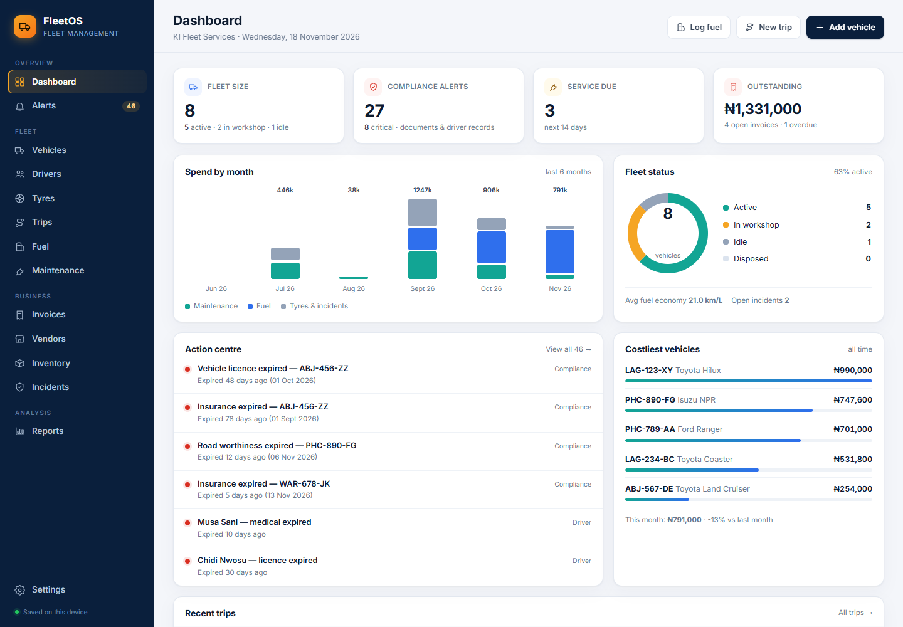
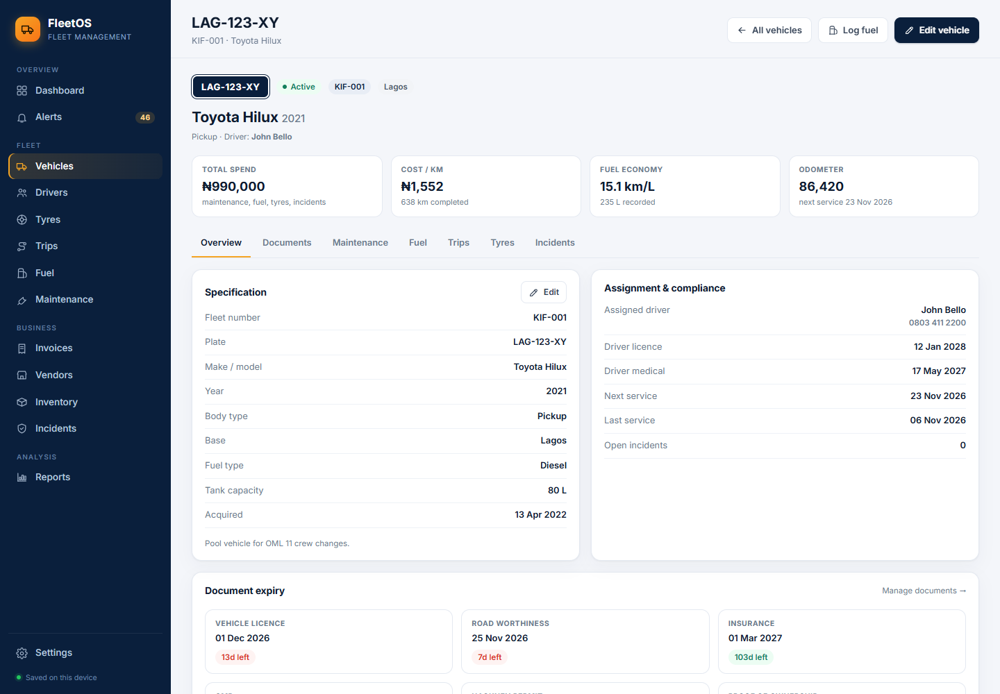
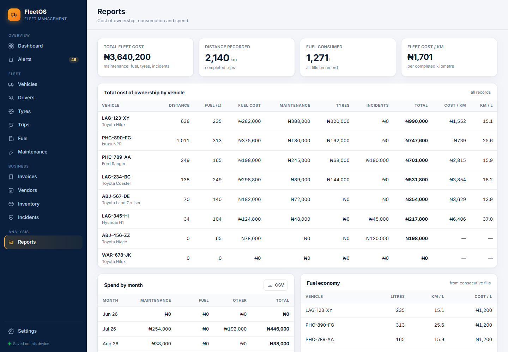

# FleetOS — Fleet Management

**Live demo:** https://emmaniche.github.io/fleet-management-app/

A local-first fleet management app built from the **Fleet Management Report** workbook in `docs/`.
No build step, no backend, no accounts: open `index.html` and the app runs, saving everything in the browser.



## Quick start

**Option 1 — double-click**
Open `index.html` in Chrome, Edge or Firefox.

**Option 2 — local server**

```bash
python -m http.server 8080
# then open http://localhost:8080
```

On first run you can load a demo fleet (8 vehicles, drivers, trips, fuel, work orders, invoices)
or start with an empty register. Demo data can be cleared at any time in **Settings**.

## Modules

| Module | What it covers |
| --- | --- |
| **Dashboard** | Fleet size, compliance alerts, service due, outstanding payments, 6-month spend, status mix, action centre, costliest vehicles |
| **Vehicles** | Fleet register with plate, make/model, driver, odometer, base and six statutory document dates. Click any row for a full vehicle profile |
| **Drivers** | Licence and medical expiry, contact details, base, assigned vehicles |
| **Tyres** | Fitment by position, brand/size, tread depth, fitment odometer, cost |
| **Trips** | Movement requests with client, route, distance, passengers, escort/police detail and approval status |
| **Fuel** | Fills with litres, cost, odometer and station; cost per litre and km/L from consecutive fills |
| **Maintenance** | Work orders with workshop, parts, cost and next service due |
| **Inventory** | Spare parts stock, reorder levels and stock value |
| **Vendors** | Workshops and suppliers with ratings, invoiced value and job counts |
| **Invoices** | Vendor invoices, WCC/payment status, payment advice and due dates |
| **Incidents** | Accidents, damage, theft, breakdowns and fines with insurance claims |
| **Alerts** | One queue for document expiry, service, driver records, stock, payments and open incidents |
| **Reports** | Cost of ownership by vehicle, cost per km, fuel economy, monthly spend — all exportable |
| **Settings** | Company name, currency, alert windows, payment terms, JSON backup/restore, demo load, erase |

## What was added beyond the workbook

The workbook covered the register, maintenance, movements and invoices. The app adds the
operational modules a fleet company needs around them:

- **Driver compliance** — licence and medical expiry feed the same alert engine as vehicle papers.
- **Fuel control** — consumption per fill, cost per litre, and km/L derived from consecutive odometer readings.
- **Tyre management** — position-level fitment history and tread-depth warnings.
- **Parts inventory** — reorder levels with automatic low-stock and out-of-stock alerts.
- **Vendor register** — ratings plus invoiced value and job counts per workshop/supplier.
- **Trip approvals** — request → approved → in progress → completed, with escort and police numbers for hostile-environment moves.
- **Incidents & claims** — repair cost, claim status and claim amount, linked to vehicles and drivers.
- **Cost of ownership** — maintenance + fuel + tyres + incidents per vehicle, cost per kilometre and fleet-wide totals.
- **Alerts engine** — configurable windows (default 30 / 90 days) across documents, drivers, service, stock, invoices and incidents.
- **CSV export** on every register; **JSON backup/restore** for the whole database.
- **Demo fleet** — Nigerian operation with clients WAGL, Total, Chevron and NNPC, priced in ₦.

## Vehicle profile

Each vehicle opens a dedicated page with total spend, cost per km, fuel economy and odometer,
plus tabs for documents, maintenance, fuel, trips, tyres and incidents.



## Reports



## Project structure

```
index.html        app shell and script order
styles.css        design system: navy sidebar, amber accent, KPI cards, tables, modals
store.js          schema, demo data, persistence, derived costs, alerts, CSV helpers
ui.js             icons, table engine (search/filter/sort/CSV), forms, modals, toasts
dashboard.js      dashboard, alerts page, reports
app.js            router, navigation, module screens, vehicle detail, settings, first run
docs/             Fleet Management Report.xlsx and screenshots
```

Scripts are classic (non-module) so the app works from `file://` without CORS problems.

## Data and privacy

- Everything is stored in `localStorage` under the key `fleetos.v1` — on this browser, on this device only.
- Nothing is sent anywhere; there is no server and no analytics.
- Use **Settings → Download backup** before clearing browser data or moving to another machine.
- Restoring a backup replaces all current records.
- The app is single-user by design. For multi-user access, the data layer in `store.js` can be pointed at a hosted API without changing the screens.

## Currency and thresholds

The currency symbol defaults to `₦` and is configurable in Settings. Alert windows default to
30 days (critical) and 90 days (watch), and invoice terms default to 30 days.

## Source workbook

`docs/Fleet-Management-Report.xlsx` is the workbook this app was built from: dashboard, fleet
register, maintenance log, movement log, invoice log and a hidden lists sheet. The app extends it
rather than replacing it — the workbook remains the printable/reporting view.
